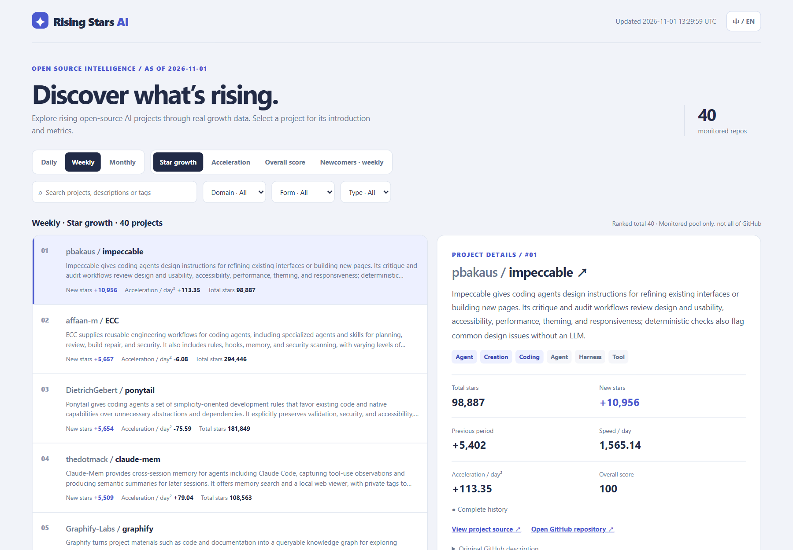

# Rising Stars AI

[Live dashboard](https://yin52133.github.io/rising-stars-ai/) · [GitHub repository](https://github.com/yin52133/rising-stars-ai) · [简体中文](docs/readme-cn.md)

Discover open-source AI projects gaining attention on GitHub. Rising Stars AI helps you explore what is growing, how quickly its momentum is changing, and what each project does.

**Rankings cover the monitored pool, not all of GitHub.** Check the dashboard for its data cutoff and last update.



*Dashboard preview using a data snapshot.*

## Explore the rankings

- **Choose a period:** daily, weekly, or monthly. The newcomers ranking is weekly only.
- **Compare growth:** see new stars and how growth speed has changed. Negative acceleration means growth is slowing; it does not necessarily mean stars were lost.
- **Use the overall score:** compare projects using growth and acceleration together. Total stars do not determine the score.
- **Find a project:** search or filter by category, then select a project to read its introduction and metrics. Switch between English and Chinese at any time.

Unavailable metrics show `—` rather than zero. Some projects may show their original GitHub description until a bilingual introduction is available.

## Run locally

You need Python 3.12 and a network connection. A GitHub token is recommended to reduce request limits.

1. Install the dependencies from the repository root:

   ```bash
   python -m pip install -r requirements.txt
   ```

2. Create a `.env` file in the repository root with your token, without quotes:

   ```text
   GITHUB_TOKEN=your_github_token
   ```

   Do not commit or share your token. An environment variable named `GITHUB_TOKEN` also works and takes precedence over `.env`.

3. Generate the rankings:

   ```bash
   python -m rising_stars_ai daily
   ```

4. Open `data/rankings/index.html` in a browser. Check the data cutoff and update time shown on the page.

If the command reports that no star history is available, check your network connection, token, and request results. Viewing an already generated page requires neither Python nor a token.
