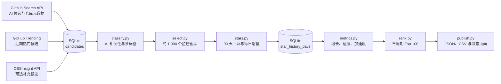

# Rising Stars AI

发现正在增长的 GitHub AI 项目。维护约 1,000 个精算监控仓库，输出日、周、月 Top 100。

## 1. 范围

关注 AI 提效项目：编程与工程辅助、Agent 与 Harness、新模型与复刻、研究自动化、办公、AI 创作、3D 建模、部署与评测基础设施。

- 外部趋势来源负责**发现候选**，不直接决定名次。
- GitHub 官方 Star 历史接口负责**统一计算数据**。
- 绝对增长和加速度等权形成综合榜；总 Star 不参与综合分。
- Top 100 是当前监控池内排名，不宣称全站无遗漏。
- 不读取每日榜单归档仓库作为数据源。

## 2. 数据流



**OSSInsight 不是硬依赖。** 其 API 可用性、事件覆盖和指标口径未验证前，只作为候选补充，不参与最终 Star 计算。

## 3. 数据源契约

| 来源 | 输入 | 输出 | 不负责 |
|---|---|---|---|
| GitHub Search API | AI Topics、名称、简介、README 关键词；创建时间和 Star 分段 | 仓库 ID、名称、简介、Topics、总 Star、创建时间、`pushed_at`、归档状态 | 全站涨幅查询 |
| GitHub Trending | 日／周热门页面 | `owner/repo`、发现时间、来源 URL | 历史回填、最终名次 |
| OSSInsight API | 经验证可用的趋势／集合接口 | 候选仓库、外部热度证据 | 统一 Star 口径 |
| GitHub Star History API | 监控池 `owner/repo` | 按日新增 Star、周标识 | 候选发现 |
| GitHub Repository API | 已监控仓库 ID／名称 | 当前总 Star、名称变更、归档状态 | 每日新增量 |

按 GitHub 仓库 ID 去重，名称只是展示字段。所有候选保存来源、来源 URL、首次和最近发现时间。

## 4. 仓库布局

```text
rising-stars-ai/
├── docs/
│   └── design.md
├── rising_stars_ai/
│   ├── discover.py       # 多来源发现与去重
│   ├── classify.py       # AI 过滤、领域与技术标签
│   ├── select.py         # 监控池配额、晋级与降级
│   ├── stars.py          # 官方历史回填与增量更新
│   ├── metrics.py        # 窗口指标
│   ├── rank.py           # 百分位综合分与 Top 100
│   ├── db.py             # SQLite 持久化
│   └── publish.py        # JSON、CSV 和静态页面
├── config/
│   ├── taxonomy.yml      # 领域、技术形态和分类规则
│   └── sources.yml       # 查询、来源和调度参数
├── data/
│   └── rankings/         # 可重新生成的公开结果
├── tests/
│   └── test_metrics.py
└── .github/workflows/
    └── update.yml
```

技术栈：Python、SQLite、静态页面。原始数据与计算结果分离，修改算法后可离线重算。

## 5. 发现与筛选

### 5.1 候选发现

Search API 按关键词、创建时间和 Star 区间拆分查询；每次查询最多 1,000 条结果，不通过单次宽查询假装全站覆盖。

Trending 只提供当前热门候选。其他外部来源必须记录具体证据，不把其榜单名次导入本地排名。

### 5.2 粗筛

常规候选：

```text
公开仓库、非归档、非模板
当前 Star >= 500
近一年 pushed_at 有更新，或近期增长证据足够强
通过 AI 相关性筛选
```

`pushed_at` 只代表近期推送，不等于持续开发。默认排除普通 Fork；模型、应用或引擎复刻保留并记录复刻对象。

新锐候选可以低于 500 星：近期创建、外部趋势提示爆发或多个来源共同命中。没有合适项目时不补满名额。

### 5.3 AI 分类

Topics、名称和简介做初筛；准备入池的候选读取 README 复核。输出：

```text
included: bool
domains: [编程, Agent, 研究, 创作, 建模, ...]
forms: [模型, Agent, Harness, 工具, 基础设施, ...]
kind: tool | model | replica | resource_list
evidence: [分类依据]
confidence: 分类可信程度
```

一个仓库允许多个领域与技术标签。产品本身与 AI 无关、只是开发时使用 AI 的仓库排除。Awesome、课程等默认标为 `resource_list`，不进入主榜。

## 6. 监控池

| 池 | 规模 | 内容 |
|---|---:|---|
| 候选池 | 不固定 | 基础元数据、来源、AI 分类，不逐个精算历史 |
| 常规监控池 | 约 800 | 各领域成熟或持续增长的 AI 项目 |
| 新锐观察池 | 最多 200 | 新项目、突发增长、低星潜力项目 |
| 展示榜 | 每榜 100 | 从约 1,000 个精算对象计算 |

粗筛优先级只决定监控谁，不参与最终榜分。各领域先保留基础名额，再按近期表现分配机动名额，避免 Agent 和编程工具挤满全榜。

每周调整一次：高热候选晋级；连续多个周期低热或范围不符者降级；归档项目移出榜单但保留历史。人工保留或排除必须记录原因。

## 7. Star 采集与统一口径

接口：

```http
GET /repos/{owner}/{repo}/stargazers/history
```

- 新入池先取最近 90 天；更早历史后台补录，不阻塞出榜。
- 已入池每日只更新最近未完成周期，按仓库和日期 upsert。
- 保存原始响应、页码、来源和采集时间。
- 失败记为缺测，禁止写零。
- 当前总 Star 另存快照。

**默认排名使用历史接口的新增 Star。** 两次总 Star 快照相减得到净变化，包含取消 Star 等影响，只能单独展示。

官方历史日／周边界不保证按 UTC 对齐。页面展示实际统计窗口和更新时间，不把官方新增量与自己的 UTC 快照差值混算。

## 8. 核心算法

对窗口 `W ∈ {1, 7, 30}`，令 `G_W(t)` 为最近一个完整 W 天窗口新增 Star：

```text
V_W(t) = G_W(t) / W
A_W(t) = (V_W(t) - V_W(t-W)) / W
```

- 日：昨天对比前天。
- 周：最近完整七天对比再前七天。
- 月：最近完整三十天对比再前三十天，使用滚动窗口。
- 加速度单位：Star/天²；负值表示仍可能增长，但增速下降。

历史要求：日指标 2 天、周指标 14 天、月指标 60 天。不足时加速度为 `null`，可进入绝对增长榜或新锐榜，不进入对应加速度／综合榜。

### 综合排名

在同一周期、同一合格候选集合中，将指标转为 0–100 百分位 `P`，并列使用平均排名：

```text
Score_W = 0.5 * P(G_W) + 0.5 * P(A_W)
```

这是排名等权，不直接相加不同量纲。总 Star 不进入默认综合分。平分依次按绝对增长、加速度、仓库 ID 排序。

## 9. 数据库

| 表 | 主键／约束 | 内容 |
|---|---|---|
| `repositories` | `repo_id` | 当前名称、元数据、创建时间、归档状态 |
| `discovery_sources` | `(repo_id, source, source_key)` | 来源、URL、证据、首次／最近发现时间 |
| `repository_labels` | `(repo_id, label)` | 多标签、依据、分类方式、置信度 |
| `pool_memberships` | `(repo_id, valid_from)` | 池类型、有效期、晋级／降级原因 |
| `star_history_days` | `(repo_id, day)` | 官方新增量、周标识、来源、采集时间 |
| `star_total_snapshots` | `(repo_id, captured_at)` | 当前总 Star |
| `collection_runs` | `run_id` | 来源、状态、请求量、错误、数据截止时间 |
| `metric_windows` | `(repo_id, window, end_day)` | 本期／上期新增、速度、加速度、完整性 |
| `ranking_snapshots` | `(window, board, end_day, repo_id)` | 指标、百分位、综合分、名次 |

## 10. 调度与发布

```text
每日：discover → classify → select 候补 → stars 增量 → metrics → rank → publish
每周：select 重排监控池，处理晋级与降级
后台：低优先级补完整历史
```

日、周、月榜来自同一历史表，不维护三套抓取任务。

输出：

```text
daily_growth_top100.json
daily_acceleration_top100.json
daily_score_top100.json
weekly_*_top100.json
monthly_*_top100.json
newcomers_top100.json
```

页面提供周期、领域、技术形态和项目类型筛选；每项显示总 Star、本期／上期新增、速度、加速度、综合分及数据完整性。CSV 与 JSON 保留原始指标，不能只导出综合分。

页头明确：监控池范围、实际仓库数、统计窗口、数据更新时间和缺测状态。

## 11. 实施顺序

1. SQLite、Search API 候选发现和 AI 规则分类。
2. 监控池选择与 90 天历史回填。
3. 指标、综合排名和固定样本测试。
4. 每日增量与 Top 100 JSON／页面。
5. 接入 Trending 补充发现。
6. 验证 OSSInsight 数据后，作为可选候选来源。

## 12. 验收

- 候选来源可追溯，仓库按 ID 去重。
- 90 天回填和每日增量不会重复计数。
- 同一批数据可重算日、周、月原始指标与榜单。
- 固定样本覆盖增长、加速度、并列、窗口边界和历史不足。
- 请求失败不写零；过期数据有标记。
- 监控池不超过设定规模，晋级／降级有原因。
- Top 100 可从保存的原始历史完整重算。
