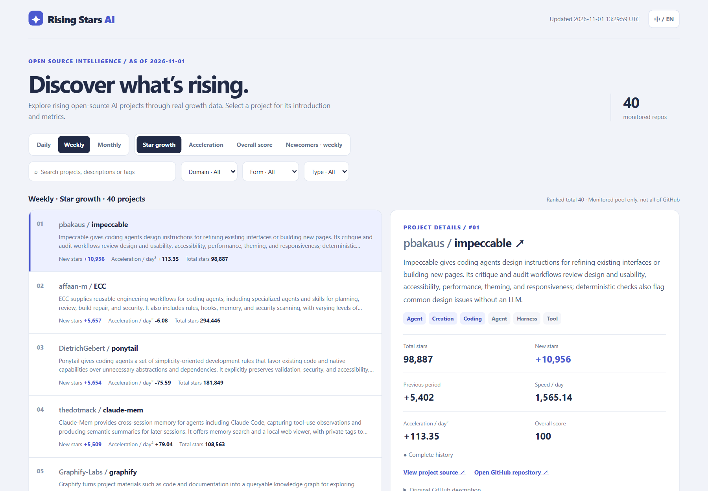

# Rising Stars AI

[在线榜单](https://yin52133.github.io/rising-stars-ai/) · [GitHub 仓库](https://github.com/yin52133/rising-stars-ai) · [English](../README.md)

发现 GitHub 上正在受到关注的 AI 开源项目。Rising Stars AI 帮你了解哪些项目正在增长、增长势头如何变化，以及每个项目能做什么。

**排名范围是当前监控池，不代表 GitHub 全站。** 数据截止日期和更新时间以榜单页面为准。



*使用数据快照的榜单界面预览。*

## 看榜单

- **选择周期**：查看日榜、周榜或月榜；新锐榜只提供周榜。
- **比较增长**：查看新增 Star 和增长速度的变化。加速度为负表示增长放缓，不一定表示 Star 减少。
- **查看综合评分**：结合增长和加速度比较项目，总 Star 不决定综合分。
- **查找项目**：搜索或按类别筛选，选中项目后查看介绍和指标；页面支持随时切换中英文。

暂不可用的指标显示为 `—`，不会按零计算。尚未整理双语介绍的项目会显示 GitHub 原始简介。

## 本地运行

需要 Python 3.12 和网络连接；建议使用 GitHub Token 以减少请求限流。

1. 在仓库根目录安装依赖：

   ```bash
   python -m pip install -r requirements.txt
   ```

2. 在仓库根目录创建 `.env` 文件，填入 Token，值不要加引号：

   ```text
   GITHUB_TOKEN=your_github_token
   ```

   不要提交或分享 Token。也可设置同名环境变量；环境变量优先于 `.env`。

3. 生成榜单：

   ```bash
   python -m rising_stars_ai daily
   ```

4. 用浏览器打开 `data/rankings/index.html`，查看页面显示的统计截止日期和更新时间。

如果提示没有 Star 历史，检查网络、Token 和请求结果。查看已生成的页面不需要 Python 或 Token。

## Star 历史

[](https://www.star-history.com/?repos=yin52133%2Frising-stars-ai&type=date&legend=top-left)
